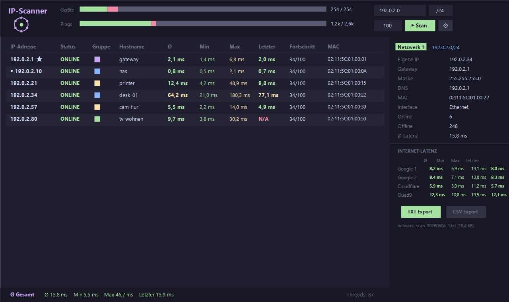

# IP-Scanner

Windows desktop network scanner. Pings every host in one or more IPv4 or IPv6 networks,
resolves hostnames and MAC addresses, and shows live latency statistics in a
dark, table-focused UI. Built with C# / WPF on .NET 8, ships as a single
self-contained exe.



## Features

- Two-phase scan: fast discovery sweep, then a configurable number of analysis
  pings per device - devices join the run the moment they answer
- Known devices appear instantly at scan start with their stored hostname and
  MAC; live results replace the stored values during the run
- Devices that just dropped offline get a quick ping burst, so short dropouts
  recover within seconds; offline IPs keep being rechecked during the run
- Hostname/MAC resolution over several techniques in parallel (ARP, reverse
  DNS, mDNS, NetBIOS); the first result shows immediately, better ones replace
  it - MAC addresses are found across additional local subnets too
- Latency table with min/avg/max/last, heatmap colors, best/worst markers and
  a totals row; edit hostnames and group colors right in the table
- Click a device's latency column to expand a live ping-history graph under
  its row (full width, time markers, optional auto-open for pinned devices)
- Up to ten latency history graphs (any device or the network average),
  per-network mini graphs, plus an internet latency panel with its own
  totals and graph - all with time markers and a configurable window
- Smooth under load: the logo animation has its own render thread and the
  graph math runs on a worker thread
- Pin IPs from the table or the sidebar - pinned entries carry an optional
  name and color that show up everywhere
- Subnets, pinned IPs and internet hosts managed in the sidebar, each with an
  optional name and color
- Device grouping by MAC vendor and hostname prefix, gateway highlighted
- Device detail view lists every open TCP/UDP port with name and version;
  an optional full 1-65535 port scan (with progress and cancel) goes beyond
  the ~190 well-known ports the automatic scan checks
- Sidebar width is a drag handle (240-560 px), remembered across restarts
- Known-devices database (SQLite), mergeable between instances, upgraded
  automatically after app updates
- TXT/CSV/XML/JSON/grepable reports, toggled at the top of the sidebar with file name and size shown
- A header switch to quickly hide or show known-but-offline devices from the database
- Ten UI languages (English, German, Spanish, French, Chinese, Hindi, Arabic,
  Portuguese, Russian, Japanese) - switch instantly, no restart, or follow the
  Windows language automatically; adjustable text size
- Settings save instantly, persist as a .conf you can relocate, export and
  import
- IPv6 targets next to IPv4, with open, closed and filtered port states and
  several scan types
- Service and version detection on open ports, plus an OS estimate per device
- Tools window (non-modal) with the individual scan tools, each on its own page
  and running in the background while you switch
- Scan archive: every scan is kept and can be compared with another one; the
  comparison can be copied or saved as a file
- Full backup and restore as one ZIP, optionally protected with a password
  (AES); scan profiles for quick switching between setups
- Notes and mute per device, and a log page inside the app
- Command line: the same `IP-Scanner.exe` runs scans from a terminal or a script (see below)

Release history: see [CHANGELOG.md](CHANGELOG.md).

## Build

Requires the .NET 8 SDK on Windows.

```
build.bat
```

produces `dist\IP-Scanner.exe` (self-contained,
single-file, no .NET install needed). Equivalent manual command:

```
dotnet publish src\IpScanner\IpScanner.csproj -r win-x64 --self-contained -c Release -p:PublishSingleFile=true -p:IncludeNativeLibrariesForSelfExtract=true -p:DebugType=none -p:DebugSymbols=false -o dist
```

For development:

```
dotnet build IP-Scanner.slnx
dotnet test IP-Scanner.slnx
```

## Command line

`IP-Scanner.exe <options>` scans from a terminal or a script and writes text, XML, JSON or
grepable reports. With options it runs without a window and prints into the console it was
started from; without options it opens the app. There is no separate command line program.

`IP-Scanner.exe` is a window program, so `cmd.exe` and PowerShell do not wait for it: the prompt
may return before the output appears and the exit code is not set.

- cmd: `start /wait IP-Scanner.exe <options>` waits and sets `%errorlevel%`, but it cannot be
  combined with `>` (the redirect would apply to `start`). To save the output run
  `IP-Scanner.exe <options> > report.txt` without `start`, from a batch file, or use `-oN <file>`.
- PowerShell: `>` writes an empty file. Pipe instead: `IP-Scanner.exe <options> | Out-File report.txt`
  or `| Out-Host`. A pipe makes PowerShell wait and sets `$LASTEXITCODE`.

### What this tool is and is not

IP-Scanner is for diagnosing your own network. It shows which devices answer, which ports are open and which services run there. It is not a penetration testing suite and does not attack systems.

Only scan networks you are responsible for. Scanning other networks can be against the law.

### Usage

Call `IP-Scanner.exe [options] <target>...`. A target is a single address, a host name, a CIDR block (`192.168.1.0/24`), a range (`192.168.1.10-50`), per-octet ranges (`10.0.0-3.1-254`), or a list of these separated by commas or spaces. With `-6` the targets are IPv6 instead: an address (`2001:db8::1`, `fe80::1%12` with the interface number for a link-local one), a prefix (`2001:db8::/112`) or a range (`2001:db8::1-2001:db8::40`). A prefix or range may cover at most 65536 addresses. Without `-sn`, `-sL` or `-Pn` the live hosts get a port scan of the 1000 most common ports (TCP connect).

### Options

**Targets**

| Option | What it does |
| --- | --- |
| `-iL <file>` | Read targets from a file, one spec per line. |
| `--exclude <specs>` | Comma separated targets to leave out. |
| `--exclude-file <file>` | Read the targets to leave out from a file. |
| `-6` | Scan IPv6 targets. Required for them, and IPv4 targets are then refused. |

**Scan type**

| Option | What it does |
| --- | --- |
| `-sn` | Discovery only: find the live hosts, scan no ports. |
| `-Pn` | Skip discovery and treat every target as up. |
| `-sL` | List the targets with their reverse names, send nothing to them. |
| `-sT` | TCP connect scan (default, needs no driver). |
| `-sS` | TCP SYN scan (needs the packet driver). |
| `-sU` | UDP scan; alone it replaces the TCP scan, with a TCP type it adds to it. |
| `-sF` | TCP FIN scan (needs the packet driver and --allow-aggressive). |
| `-sX` | TCP Xmas scan (needs the packet driver and --allow-aggressive). |
| `-sN` | TCP Null scan (needs the packet driver and --allow-aggressive). |
| `-sA` | TCP ACK scan: maps firewall rules (needs the packet driver). |
| `-sW` | TCP window scan (needs the packet driver). |
| `-sM` | TCP Maimon scan (needs the packet driver and --allow-aggressive). |

**Ports**

| Option | What it does |
| --- | --- |
| `-p<ports>, --ports <ports>` | Ports to scan: 22,80,8000-9000, T:80,U:53; use -p- for all 65535 ports. |
| `-F` | Fast: the 100 most common ports. |
| `--top-ports <n>` | Scan the n most common ports. |

**Detection**

| Option | What it does |
| --- | --- |
| `-sV` | Identify the service and version behind each open port. |
| `--version-intensity <0-9>` | How hard -sV probes (0 listens only, 9 tries every probe). |
| `-O` | Estimate the operating system (needs the packet driver). |
| `--checks <list>` | Run service checks: safe, discovery, intrusive (comma separated). |

**Timing**

| Option | What it does |
| --- | --- |
| `-T<0-5>` | Timing template, 0 paranoid to 5 insane (default 3). |
| `--min-rate <n>` | Send at least n probes per second. |
| `--max-rate <n>` | Send at most n probes per second. |
| `--max-retries <n>` | Retransmissions per probe. |
| `--host-timeout <time>` | Give up on a host after this time (ms, s, m or h suffix). |

**Output**

| Option | What it does |
| --- | --- |
| `-oN <file>` | Write the text report to a file (- for stdout). |
| `-oX <file>` | Write the XML report to a file (- for stdout). |
| `-oJ <file>` | Write the JSON report to a file (- for stdout). |
| `-oG <file>` | Write the grepable report to a file (- for stdout). |
| `--reason` | Show why each port got its state. |
| `--open` | Report only open (and open\|filtered) ports. |

**Safety gates**

| Option | What it does |
| --- | --- |
| `--allow-full-scan` | Allow a chosen scan of more than 100 ports (-p) or a --top-ports count above 1000, up to all 65535. |
| `--allow-large` | Allow more than 65536 targets. |
| `--allow-intrusive` | Allow the intrusive check category. |
| `--allow-aggressive` | Allow the FIN, Null, Xmas and Maimon scans. |
| `--i-know-what-i-am-doing` | Hide the notice printed for aggressive scans (the gates above still apply). |

**Miscellaneous**

| Option | What it does |
| --- | --- |
| `--interface <ip\|name>, -e <ip\|name>` | Send from this network adapter (IPv4 address or adapter name). Applies to IPv4 targets; IPv6 targets leave through the adapter the system routes them over. |
| `-v, -vv, -vvv` | More progress on stderr (-vv for per-host detail). |
| `-d` | Debug log on stderr. |
| `-h, --help` | Show this help. |
| `--version` | Show the version. |

### Notice for aggressive scans

A run that is long, noisy or easy to notice (all ports, fast timing with `-T4`/`-T5`, FIN, Null, Xmas and Maimon scans, intrusive checks) prints a one-time notice on stderr and then runs. The report on stdout stays clean. `--i-know-what-i-am-doing` hides the notice and changes nothing else: the safety gates still apply.

### Examples

The excerpts show the start of the output. Addresses are from the documentation ranges `192.0.2.0/24` and `2001:db8::/32`, so replace them with your own. Hosts, versions and timings here are sample values.

**Find the live hosts of a subnet.**

```
IP-Scanner.exe -sn 192.0.2.0/28
```

The table lists every host that answered.

```text
IP address      Status        Hostname ...
192.0.2.1       ONLINE        - ...
192.0.2.10      ONLINE        - ...
```

**Scan three ports and write a JSON report.**

```
IP-Scanner.exe -p 22,80,443 -oJ out.json 192.0.2.10
```

The report goes to the screen and to `out.json`.

```text
192.0.2.10:
  22/TCP    ssh OpenSSH 9.6
  80/TCP    http nginx 1.24
  443/TCP
```

**Scan the 100 most common ports and identify the services.**

```
IP-Scanner.exe -F -sV 192.0.2.1-20
```

`-sV` adds the service name and version behind each open port.

```text
Open ports:
192.0.2.1:
  22/TCP    ssh OpenSSH 9.6
```

**Scan the 50 most common UDP ports.**

```
IP-Scanner.exe -sU --top-ports 50 192.0.2.10
```

Alone, `-sU` replaces the TCP scan. Combine it with `-sT` or `-sS` to scan both.

```text
192.0.2.10:
  53/UDP
  123/UDP
```

**SYN scan of all 65535 ports (packet driver needed).**

```
IP-Scanner.exe -sS -p- --allow-full-scan 192.0.2.10
```

A chosen scan of more than 100 ports (or a `--top-ports` count above 1000) needs `--allow-full-scan`. Because it is long and noisy, a notice is printed on stderr (see below).

```text
Open ports:
192.0.2.10:
  22/TCP    ssh OpenSSH 9.6
```

**Read targets from a file, leave one out, write XML.**

```
IP-Scanner.exe -iL hosts.txt --exclude 192.0.2.1 -oX scan.xml
```

`hosts.txt` holds one target per line. The XML report is written to `scan.xml`.

```text
Open ports:
192.0.2.10:
  80/TCP    http nginx 1.24
```

**List the addresses and their names without sending anything.**

```
IP-Scanner.exe -sL 192.0.2.0/30
```

Nothing is sent to the targets. Only the reverse name lookup runs.

```text
192.0.2.1       Listed        - ...
192.0.2.2       Listed        - ...
```

**Skip discovery, scan faster, show only open ports and why.**

```
IP-Scanner.exe -Pn -T4 --open --reason 192.0.2.10
```

`--reason` adds the cause of each state. `-T4` is fast timing and prints the notice described below.

```text
192.0.2.10:
  22/TCP    ssh OpenSSH 9.6  (syn-ack)
  80/TCP    http nginx 1.24  (syn-ack)
```

**Scan, then run the safe and discovery service checks.**

```
IP-Scanner.exe --checks safe,discovery 192.0.2.10
```

The checks run against the open services and are listed per host.

```text
Checks:
192.0.2.10:
  http-title (80/TCP): Found
    title: Welcome
```

**Estimate the operating system and identify the services (packet driver needed).**

```
IP-Scanner.exe -O -sV 192.0.2.10
```

The estimate is shown in the last column. It is a guess, never a certainty.

```text
192.0.2.10      ONLINE        - ...
Linux/Unix ~85 % (estimate)
  22/TCP    ssh OpenSSH 9.6
```

**Text report on stdout, grepable report in a file.**

```
IP-Scanner.exe -oN - -oG hosts.gnmap 192.0.2.0/24
```

`-oN -` prints the text report to the terminal. The grepable report goes to `hosts.gnmap`.

```text
NETWORK SCAN REPORT
Command line: -oN - -oG ...
```

**Scan an IPv6 host.**

```
IP-Scanner.exe -6 -p 22,80,443 2001:db8::10
```

`-6` is required for IPv6 targets. The report lists the host under its short address.

```text
2001:db8::10:
  22/TCP    ssh OpenSSH 9.6
  80/TCP    http nginx 1.24
  443/TCP
```

### Exit codes

| Code | Meaning |
| --- | --- |
| 0 | The scan finished. |
| 1 | The scan could not run or failed (no network, driver missing, file not writable). |
| 2 | Wrong usage: unknown option, bad value, no target, or a safety gate was not opened. |
| 3 | Stdout was closed before the report was printed (for example by \| head); report files were still written. |
| 130 | Stopped with Ctrl+C; the partial result was still written. |

## Notes

### Where your data lives

All of this lives next to the exe by default (relocatable in Settings) and
stays on your machine. The update check and the internet latency ping are asked
about on first start; nothing else leaves the PC:

- `ip_scanner.conf` - your settings: which subnets/IPs/hosts to scan, colors,
  thresholds, language, theme. Plain text, not encrypted.
- `scanner.db` - the known-devices database (SQLite): IP, MAC, hostname and
  last-seen time for every device the scanner has recorded, plus the scan
  archive. Sealed for your Windows account.
- `overrides.dat` and `settings.dat` - your device overrides and sensitive
  settings. Sealed for your Windows account like the database.
- `Scans\` - TXT/CSV/XML/JSON/grepable scan reports, if you enable them.
- Backup ZIPs you create from the settings, where you choose to save them.
- `error.log` - a rotating crash/error log (capped at 5 MB), next to the exe.

The database and the device data are sealed with a key tied to your Windows
account, so copying the files to another account or PC does not expose them
(use the backup feature to move your data). The config, exports and error log
stay plain text on purpose. The app also tightens the NTFS permissions on the
folder to your own user account. If your threat model needs disk encryption,
use BitLocker or an encrypted volume for the whole folder.
